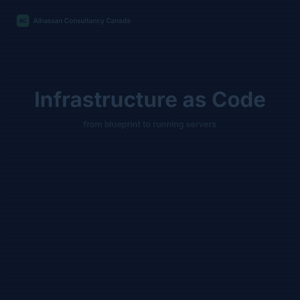
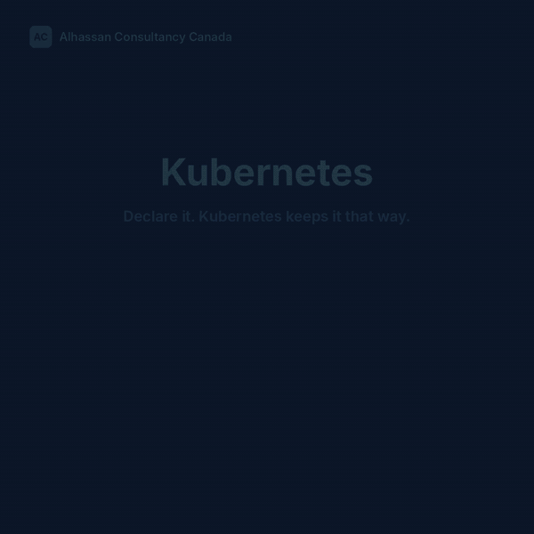

[🌌 View the black-and-Milky-Way themed page](index.html) · [Open HTML source](https://github.com/hassankx/linux-infrastructure-toolkit/blob/main/index.html)

> GitHub README pages use GitHub's own theme. Download `index.html` and open it in a browser to see the full starfield design.

# linux-infrastructure-toolkit

A read-only health check for Linux hosts. Run it when you inherit a server, before a change window, or as the first step in an incident, and it tells you in under a second what needs attention.

Nothing on the host is changed. The script only reads `/proc`, `/etc` and the output of standard tools.

## What it checks

| Area | Checks |
| --- | --- |
| System | OS release, kernel, uptime (warns past 180 days without a reboot) |
| CPU | 5-minute load relative to CPU count |
| Memory | Available memory and swap use |
| Filesystems | Space and inode use against a threshold, unexpected read-only mounts |
| Services | Failed systemd units |
| Time | NTP synchronization through `timedatectl` or `chronyc` |
| Security | SELinux or AppArmor state, sshd root login and password authentication |
| Network | Default route, DNS servers, number of listening TCP sockets |
| Kernel | Error-level kernel messages since boot |

## Usage

```bash
chmod +x linux_health_check.sh
./linux_health_check.sh                      # defaults: disk 85%, load ratio 1.5
./linux_health_check.sh --disk-warn 90 --load-warn 2
```

Some checks (sshd configuration, the kernel journal) return more detail when run with `sudo`.

## Sample output

```text
== CPU load ==
  [PASS] 5-min load 0.42 on 8 CPU(s) (ratio 0.05)

== Filesystems ==
  [WARN] /var is 91% full
  [INFO] Disk threshold: 85%

== Services ==
  [PASS] No failed systemd units

== Summary ==
  1 warning(s) found. Review the [WARN] lines above.
```

## Exit codes

| Code | Meaning |
| --- | --- |
| 0 | No warnings |
| 1 | One or more warnings |
| 2 | Invalid option |

The exit code makes the script easy to call from cron, Ansible, or a monitoring check.

## Compatibility

Written for RHEL-family distributions (RHEL, Rocky, Alma) and Ubuntu/Debian with bash 4 or later. Checks that depend on a missing tool are skipped rather than failing.

## Infrastructure as Code: from blueprint to running servers



| Step | Tool | Command | What happens |
| --- | --- | --- | --- |
| 1. Write | Editor | `main.tf` | Describe the servers you need |
| 2. Plan | Terraform | `terraform plan` | Preview changes. Read-only |
| 3. Approve | Reviewer | — | A person checks the plan |
| 4. Apply | Terraform | `terraform apply` | Azure creates the servers |
| 5. Hand off | Terraform | `terraform output ips > inventory.ini` | Server IPs become the Ansible inventory |
| 6. Configure | Ansible | `ansible-playbook site.yml` | Packages, Active Directory, hardening over SSH |
| 7. Verify | Ansible | `ansible-playbook site.yml` | `changed=0`: servers match the blueprint |

Terraform builds the machines; Ansible configures what runs inside them. The health check in this repo fits naturally after step 7 as a final validation. [Full-resolution video](docs/media/iac-workflow.mp4).

Built by Alhassan Consultancy Canada Inc.

## Kubernetes administration guide

[](docs/kubernetes-administration-guide.md)

- [Kubernetes: Installation, Architecture, Administration & Troubleshooting](docs/kubernetes-administration-guide.md) — a practical learning guide for Linux administrators, DevOps engineers, and SREs.

## DevOps interview preparation

- [Senior DevOps / SRE Interview Cheat Sheet: 10 Production Scenarios](docs/devops-interview-cheat-sheet.md) — incident-focused questions, troubleshooting commands, recovery decisions, and interview-ready talking points.
- [Black-background HTML edition](docs/devops-interview-cheat-sheet-dark.html) — download the HTML file and open it in a browser for a fixed dark theme (GitHub file previews do not apply its CSS).

## License

MIT
