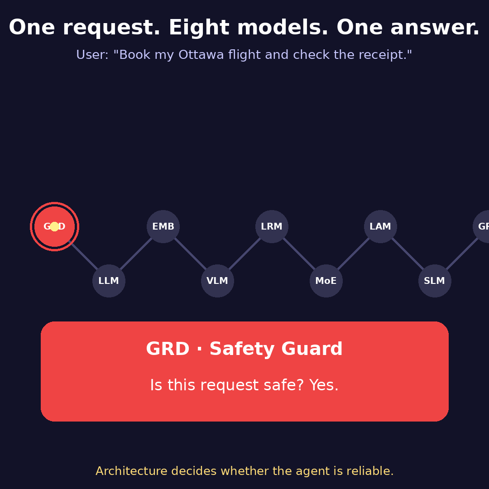

# Agentic AI: One Request, Eight Models

Last week, I watched an AI agent book a flight in under ten seconds. It was impressive. Then I asked myself the question that matters in production: what made it reliable?

Here is what happened, step by step.

A request came in: "Book my Ottawa flight and check the receipt."

First, a safety guard checked the request. Safe. Nothing harmful, nothing sensitive leaking through.

Then a language model understood what the user actually wanted: book a flight, and verify the receipt.

An embedding model searched past travel notes and found the preferences that matched this trip. Vectors made the search about meaning, not keywords.

A vision-language model read the receipt photo, so the agent could check the amount without anyone typing it in.

A reasoning model then mapped out three possible plans, checked each one, and picked the cheapest safe option.

A mixture-of-experts router sent each part of the job to the expert best suited for it, instead of running everything through one giant model.

An action model searched the flights and added a calendar hold. Intent turned into real actions in real tools.

A small, fast model wrote a short summary for the user, quickly and cheaply.

Before the reply went out, the safety guard checked it one more time.

Booked.

Most developers start with the LLM and stop there. But the agent that reliably does real work is the one where each model has a clear job, and the system is designed so they hand off cleanly. A powerful LLM alone doesn't make an intelligent agent. Architecture does.

What's the one model in your stack you'd least want to leave out?

#AgenticAI #AIArchitecture #LLM #MachineLearning #AIAgents
