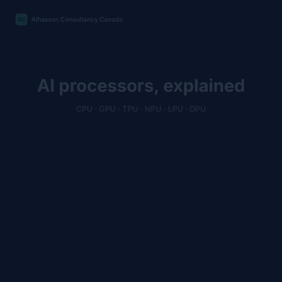

# AI processors explained: CPU, GPU, TPU, NPU, LPU, DPU

> Six processor types now appear in almost every AI infrastructure discussion. This guide explains what each one does, how work flows through it, its trade-offs, and when to choose it.

*Animated walkthrough of the six processors and one request travelling through them. [Full-resolution video](media/ai-processors.mp4).*

## At a glance

| Processor | Full name | Built for | Typical home |
| --- | --- | --- | --- |
| CPU | Central Processing Unit | Orchestration, general logic, I/O | Every server and PC |
| GPU | Graphics Processing Unit | Massive parallel math, training and deep learning | Data centers, workstations |
| TPU | Tensor Processing Unit | Tensor/matrix workloads in large pods | Google Cloud |
| NPU | Neural Processing Unit | Low-power on-device inference | Phones, AI PCs |
| LPU | Language Processing Unit | Deterministic, low-latency LLM token generation | Inference clouds |
| DPU | Data Processing Unit | Offloading networking, security and storage | Data center SmartNICs |

## CPU: the backbone

**How it works.** The operating system scheduler assigns each task to a core. Cores run complex, branching logic one thread at a time at high speed. The CPU receives the request, routes parallel math to an accelerator, handles I/O and returns the result.

**Strengths.** Handles any task, excellent single-thread performance, runs the operating system and orchestration.

**Limitations.** Slow at large parallel matrix math, not ideal for training large models, lower AI throughput than accelerators.

**Choose it for:** orchestration, preprocessing, business logic and serving as the control point of an AI pipeline.

## GPU: massive parallelism

**How it works.** Model weights are loaded into high-bandwidth memory (HBM). The work is split across thousands of small cores that run the same operation on different data at once. Matrix multiplies spread across the cores, backpropagation runs during training, and weights are updated.

**Strengths.** Massive parallelism, strong for training and inference, large software ecosystem (CUDA).

**Limitations.** High power draw, expensive, overkill for small tasks.

**Choose it for:** training and fine-tuning deep learning models, flexible inference, and workloads that need broad framework support.

## TPU: systolic arrays

**How it works.** A TPU is built around a systolic array: a grid of multiply-accumulate (MAC) cells. Weights flow in from one side and data from the other. Each cell multiplies, adds the result to a running sum, and passes values to its neighbour, so matrix math stays on the chip with little memory traffic. TPUs scale out in pods; Google's Ironwood generation links up to 9,216 chips per pod.

**Strengths.** Efficient for large tensor workloads, strong performance per watt, scales well in pods.

**Limitations.** Mostly tied to the Google Cloud ecosystem, less flexible than GPUs, more limited framework support (works best with JAX).

**Choose it for:** tensor-heavy training and large-scale serving on Google Cloud.

## NPU: AI in your pocket

**How it works.** An NPU is a small, efficient AI engine inside phones and AI PCs. Models are quantized to INT8 or INT4 so they fit in little memory and run on a few watts. Your request is handled locally, so responses arrive in milliseconds and the data stays on the device.

**Strengths.** Very low power, no cloud latency, data stays on the device.

**Limitations.** Inference only, limited model size (set by device memory), less flexible than larger accelerators.

**Choose it for:** on-device inference where privacy, latency or offline use drives the design.

## LPU: deterministic token generation

**How it works.** Groq's LPU (Language Processing Unit) carries its weights in on-chip SRAM, so weights load with no cache misses and execution is deterministic: each token takes the same, predictable time. Because each chip holds only a small amount of memory, large models are spread across many chips linked together.

**Strengths.** Extremely fast, predictable inference with very low latency.

**Limitations.** Inference only, limited memory per chip, often needs multiple linked chips.

**Choose it for:** real-time LLM serving where tight, predictable latency matters more than training.

## DPU: infrastructure offload

**How it works.** A DPU (data processing unit, such as a SmartNIC) takes over networking, encryption, firewall rules and storage I/O in hardware. Packets are processed on the card before they reach the server, so the CPU and GPUs keep their cycles for application and AI work. NVIDIA BlueField cards, for example, run at 400 Gb/s.

**Strengths.** Offloads infrastructure work, improves security, high-speed networking.

**Limitations.** Not a consumer processor, more complex to configure, niche use case.

**Choose it for:** data center infrastructure where networking, security and storage should not consume AI compute.

## One request, several chips

A single chatbot reply can touch four or more of these processors:

1. The phone's NPU may handle speech first, on device.
2. In the data center, a DPU processes the incoming packet.
3. The CPU schedules and routes the request.
4. A GPU or LPU generates the tokens.
5. The reply returns to the user.

## Quick decision guide

| Workload | Start with |
| --- | --- |
| Orchestration, preprocessing, general logic | CPU |
| Training and deep learning | GPU (or TPU on Google Cloud) |
| Large-scale tensor workloads | TPU |
| On-device, private, low-power inference | NPU |
| Real-time LLM serving with tight latency | LPU |
| Networking, encryption and storage in data centers | DPU |

Choose based on latency, parallelism, power, cost and scale. Inference is turning into its own hardware market: whether inference-only chips remain a separate category, or GPUs absorb those workloads, is an open question.

---

Built by Alhassan Consultancy Canada Inc.
