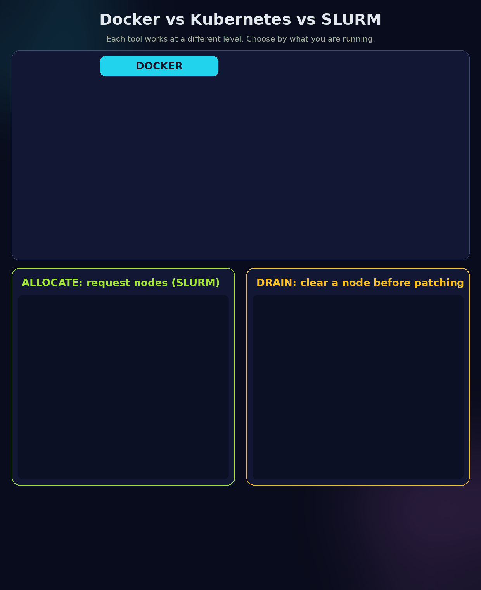
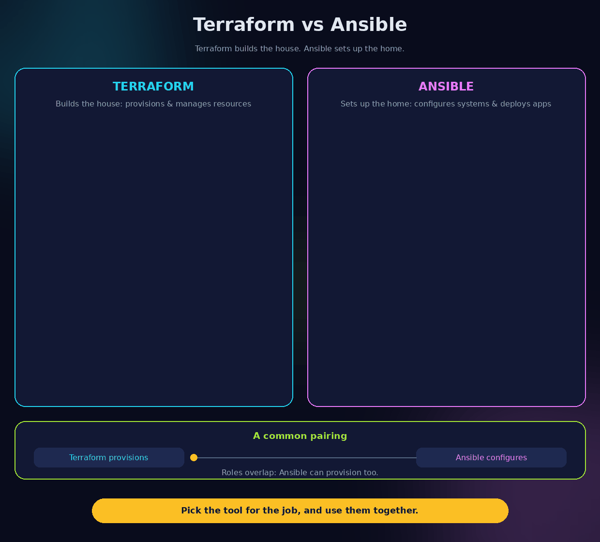
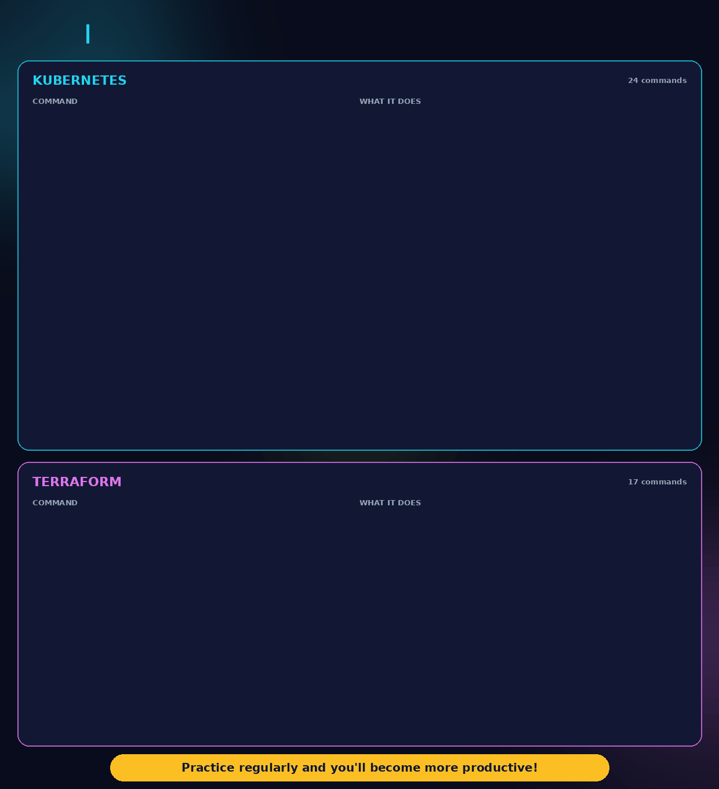

# DevOps Interview Questions, Rewritten and Answered

Each section restates the question clearly, then gives a detailed answer with a concrete example.

---

## 1. Linux and Networking

### Q1. Walk through what happens from the moment a user types a URL in a browser until a request reaches a Kubernetes pod.

**Answer.** The journey has about eight hops:

1. **DNS lookup.** The browser checks its cache, then the OS resolver, then a recursive DNS server, which asks root, TLD, and authoritative servers until it gets the IP for `shop.example.com`, for example `203.0.113.10`.
2. **TCP connection.** The browser opens a TCP socket to port 443 with a three-way handshake (SYN, SYN-ACK, ACK).
3. **TLS handshake.** The client and server agree on keys, and the server presents a certificate. The client checks the certificate chain and the domain name.
4. **Load balancer.** The public IP belongs to a cloud load balancer, which terminates TLS and forwards the request to a healthy backend.
5. **Ingress controller.** Inside the cluster, an NGINX or similar ingress controller reads the `Host` header and path, then routes `/cart` to the `cart` Service.
6. **Service.** The Kubernetes Service is a stable virtual IP. `kube-proxy` (iptables or IPVS rules) picks one healthy pod IP from the endpoints list.
7. **Pod.** The request reaches a container listening on, say, port 8080.
8. **Response.** The reply travels the same path in reverse.

**Example.** If `shop.example.com/cart` returns 502, you can check each hop in order: DNS resolves, the LB has healthy targets, the ingress has a rule for `/cart`, the Service has endpoints, and the pod answers on 8080.

### Q2. What is the difference between TCP and UDP, and where have you used each?

**Answer.** TCP is connection-oriented. It guarantees ordered, reliable delivery, using handshakes, acknowledgements, and retransmission. UDP is connectionless. It sends datagrams with no delivery guarantee and less overhead.

- **TCP:** HTTP/HTTPS, SSH, database connections, Kubernetes API traffic, NFS over TCP.
- **UDP:** DNS queries (usually), NTP time sync, syslog over UDP, metrics sent as fire-and-forget, real-time media, and VXLAN overlay traffic in Kubernetes networking.

**Example.** A health probe over TCP tells you a port accepts connections. A DNS query over UDP fails fast and the client retries; if the answer is truncated, the client retries over TCP.

### Q3. How does DNS resolution work internally?

**Answer.** A resolver walks the hierarchy. It asks a recursive resolver, which checks its cache. On a miss, it asks a root server for `.com`, then the `.com` TLD server for `example.com`, then the authoritative server for `example.com` for `shop`. Every answer carries a TTL, and caches honor it.

**Example.** Run `dig +trace shop.example.com` to see each hop. If you changed a record but clients still see the old IP, the cause is usually a TTL that has not expired yet, so plan DNS changes by lowering the TTL in advance.

### Q4. How would you debug high CPU, memory, or disk usage on a Linux server?

**Answer.** Work from the symptom to the process.

- **CPU:** `top` or `htop` to find the process, then `pidstat 1` for per-process trends. Check `vmstat 1` for run queue (`r`) and steal time (`st`).
- **Memory:** `free -h` and `vmstat`. Look for swapping (`si`/`so`), then `ps aux --sort=-%mem | head`. Check the OOM killer with `dmesg | grep -i oom`.
- **Disk space:** `df -h` for filesystems, then `du -xh / | sort -h | tail` to find large directories. Check inodes with `df -i`.
- **Disk I/O:** `iostat -xz 1` for utilization and await time, then `iotop` for the process.

**Example.** A server shows 98% CPU. `top` shows a Java process using 380%. `jstack <pid>` shows threads stuck in a regex loop, and the fix is a bounded regex and a restart.

### Q5. Explain Load Balancer, Reverse Proxy, and Ingress with real examples.

**Answer.**

- **Load balancer** spreads incoming connections across several backends and removes unhealthy ones. Example: an AWS ALB distributes requests to three EC2 instances in different zones.
- **Reverse proxy** sits in front of servers and handles requests on their behalf: TLS termination, caching, compression, and routing. Example: NGINX forwarding `/api` to a Node service on port 3000 and `/` to a static site.
- **Ingress** is a Kubernetes object that declares HTTP routing rules (host and path to Service). An ingress controller (NGINX, Traefik, or the cloud's controller) implements those rules.

**Example.** A user hits `app.example.com`. The cloud LB forwards to the ingress controller, which matches the host rule and sends `/api/*` to the `api` Service. The API pods never see the public IP.

---

## 2. Docker and Kubernetes



Docker packages an application, Kubernetes keeps services running, and SLURM schedules batch jobs on compute nodes. The ALLOCATE script requests nodes with `sbatch`, `srun` or `salloc`. The DRAIN script empties a node before maintenance and returns it to service.

### Q6. What happens internally when you run `docker run`?

**Answer.** Roughly:

1. The Docker CLI sends a request to the `dockerd` daemon through its API.
2. `dockerd` checks for the image locally. If it is missing, it pulls the image layers from the registry.
3. It creates a container from the image: a writable layer on top of read-only layers, using the overlay filesystem.
4. It sets up networking: a veth pair connects the container to a bridge (`docker0` by default), and an IP is assigned.
5. It applies resource limits and namespaces through cgroups and Linux namespaces (PID, mount, network, UTS, IPC, user).
6. It starts the process defined by `ENTRYPOINT` and `CMD`, as PID 1 inside the container.

**Example.** `docker run -d -p 8080:80 --memory=256m nginx` pulls `nginx`, creates a container, maps host port 8080 to container port 80, and caps memory at 256 MB through cgroups.

### Q7. What is the difference between CMD and ENTRYPOINT?

**Answer.** `ENTRYPOINT` sets the fixed executable. `CMD` provides default arguments, which the user can override at run time.

```dockerfile
ENTRYPOINT ["python", "app.py"]
CMD ["--port", "8000"]
```

- `docker run img` runs `python app.py --port 8000`.
- `docker run img --port 9000` runs `python app.py --port 9000`. Only `CMD` is replaced.

If `CMD` is used alone, `docker run img /bin/sh` replaces the whole command. Use `ENTRYPOINT` when the image is a tool, and `CMD` alone for flexible defaults.

### Q8. Why is a pod stuck in CrashLoopBackOff, and how would you debug it?

**Answer.** The container starts, exits with an error, and Kubernetes restarts it with growing delays (back-off). Common causes: a bad command, a missing config or secret, a failing dependency at startup, out-of-memory kills, or a failing liveness probe.

Debug steps:

```bash
kubectl describe pod <pod>            # Events: OOMKilled, probe failures, image errors
kubectl logs <pod> --previous         # logs from the crashed container
kubectl get pod <pod> -o jsonpath='{.status.containerStatuses[0].lastState}'
kubectl exec -it <pod> -- env         # check config, if the pod stays up long enough
```

**Example.** `describe` shows `Last State: Terminated, Reason: OOMKilled, Exit Code: 137`. The fix is a higher memory limit or a fix for the memory leak, not a change to the command.

### Q9. What are the differences between Deployment, StatefulSet, DaemonSet, and Job?

**Answer.**

| Object | Use it for | Key property |
|---|---|---|
| Deployment | Stateless apps (web, API) | Rolling updates, replicas, ReplicaSets |
| StatefulSet | Databases, Kafka, anything needing stable identity | Stable pod names (`db-0`, `db-1`), ordered start, per-pod storage |
| DaemonSet | One pod per node: log agents, node exporters, CNI | Runs on every (or selected) node |
| Job | Run-to-completion tasks: migrations, batch jobs | Retries until success, tracks completions |

**Example.** A web app is a Deployment with 3 replicas. A PostgreSQL cluster is a StatefulSet so `pg-0` always keeps its data volume. Prometheus node-exporter is a DaemonSet. A nightly database migration is a Job.

### Q10. What is the difference between a readiness probe and a liveness probe?

**Answer.**

- **Readiness** decides whether a pod receives traffic. A failing readiness probe removes the pod from Service endpoints, but does not restart it.
- **Liveness** decides whether a container is still alive. A failing liveness probe makes kubelet restart the container.

**Example.** A Java app takes 40 seconds to warm up. Set a readiness probe on `/healthz/ready` so traffic starts only when it is warm. Set a liveness probe on a separate, lightweight endpoint with a longer `initialDelaySeconds`, so a slow start does not cause restarts. Mixing them up (using a slow DB check as liveness) causes restart loops.

### Q11. Kubernetes pods are Running, but users receive 503 errors. What will you check?

**Answer.** A 503 from the edge usually means "no healthy backend." Work from outside in:

1. **Endpoints.** `kubectl get endpoints <svc>`. Empty means no pod passes readiness, or the Service selector does not match the pod labels.
2. **Readiness.** `kubectl describe pod` shows `Ready: False` and probe failures.
3. **Ports.** The Service `targetPort` must match the container's listening port.
4. **Ingress and LB.** The ingress backend and the cloud LB health checks must point to the right port and path.
5. **App level.** Logs show timeouts or upstream errors. A pod can be Running while the app inside is deadlocked.

**Example.** The pods are Running and `endpoints` is empty. The Deployment's label is `app: shop-v2`, but the Service selector still says `app: shop`. Fixing the selector restores traffic.

### Q12. How does Kubernetes Service discovery work?

**Answer.** Each Service gets a stable DNS name: `<service>.<namespace>.svc.cluster.local`. CoreDNS resolves it to the Service's ClusterIP. kube-proxy turns that virtual IP into load-balancing rules over the healthy pod IPs listed in the endpoints. Pods also receive environment variables for services that existed when they started, though DNS is the normal method.

**Example.** The `api` pod calls `http://payments.billing.svc.cluster.local:8080`. CoreDNS returns the ClusterIP, kube-proxy picks a payments pod, and the call goes through without the app knowing any pod IP.

### Q13. Explain ConfigMaps and Secrets. How do you manage them across environments?

**Answer.** A ConfigMap stores non-sensitive configuration. A Secret stores sensitive values such as passwords and tokens, base64-encoded. Note that base64 is encoding, not encryption, so enable encryption at rest for etcd and restrict RBAC access.

Across environments:
- Keep one chart or set of manifests and vary values per environment (Helm values files, or Kustomize overlays for `dev`, `staging`, `prod`).
- Keep secrets out of Git. Use an external store (AWS Secrets Manager, HashiCorp Vault) with the External Secrets Operator or Sealed Secrets to sync them into the cluster.

**Example.** `overlays/prod/` patches the image tag and replicas, and references `db-credentials`, which the External Secrets Operator fills from Vault using a per-environment path.

---

## 3. CI/CD

### Q14. Explain your CI/CD pipeline from code commit to production.

**Answer.** A typical pipeline has these stages:

1. **Commit and pull request.** Branch protection requires review and passing checks.
2. **Build and unit tests.** Compile, run unit tests, and run linters and static analysis.
3. **Security scan.** Scan dependencies and the container image (Trivy, Snyk).
4. **Build and push the image.** Tag it with the commit SHA, for example `shop:4f2a9c1`, and push to the registry.
5. **Deploy to staging.** Apply manifests or Helm, wait for rollout, run integration and smoke tests.
6. **Approval gate.** A manual approval for production, or automatic promotion if tests pass.
7. **Deploy to production.** Use a rolling or canary strategy, with health checks on each step.
8. **Verify and monitor.** Watch error rates and latency for a window. Roll back automatically if SLOs break.

**Example.** A GitHub Actions workflow builds `shop:4f2a9c1`, the staging job runs `helm upgrade --wait`, and a production job waits for approval, then runs the same command against the prod cluster with the same image digest.

### Q15. How do you implement zero-downtime deployments?

**Answer.** Three requirements: old and new versions run together, traffic moves only to ready pods, and shutdown is graceful.

- **Rolling update** in a Deployment: `maxUnavailable: 0`, `maxSurge: 1`, so new pods are added before old ones are removed.
- **Readiness probes** ensure traffic goes only to pods that are ready.
- **Graceful shutdown**: handle SIGTERM, stop accepting new connections, finish in-flight requests, and use a `preStop` sleep so endpoints update before the process exits.
- **Compatible database changes**: use expand-and-contract migrations, so both versions work during the rollout.

**Example.** A deployment with 4 replicas and `maxSurge: 1, maxUnavailable: 0` goes from 4 old pods to 5, then removes one old pod only after the new one passes readiness. Users see no errors.

### Q16. How would you optimize a pipeline that takes 25 minutes?

**Answer.** Measure first: find the slowest stage with the CI timing view. Then:

- **Cache dependencies** (npm, Maven, pip, Docker layers) keyed on lock files.
- **Parallelize** independent jobs: lint, unit tests, and security scans run at the same time.
- **Split tests**: run fast unit tests on every commit, and slower integration tests on merge or nightly.
- **Use smaller, cached base images** and order Dockerfile steps so dependency layers are cached.
- **Run only affected tests** in monorepos.
- **Use larger or self-hosted runners** for CPU-heavy steps.

**Example.** Dependency install drops from 6 minutes to 40 seconds with a lock-file cache. Parallel lint and test jobs save another 5 minutes. The pipeline goes from 25 to about 9 minutes.

### Q17. How do you implement rollback if a deployment fails?

**Answer.** Make the rollback path as tested as the deploy path.

- **Kubernetes:** `kubectl rollout undo deployment/shop` returns to the previous ReplicaSet. Keep `revisionHistoryLimit` above 1.
- **Helm:** `helm rollback shop <revision>`.
- **GitOps:** revert the commit in Git, and Argo CD or Flux reconciles the cluster.
- **Automated:** the pipeline runs a post-deploy health check and rolls back if error rate or readiness fails within a window.
- **Database:** only roll back code if the schema is backward compatible.

**Example.** After a release, the 5xx rate jumps from 0.1% to 12%. The canary analysis step in Argo Rollouts detects it and rolls back to the previous image within two minutes.

### Q18. How do you manage secrets securely in CI/CD pipelines?

**Answer.**
- Store secrets in the CI platform's secret store, or better, in a vault. Never put them in code, logs, or Dockerfiles.
- Use short-lived credentials: OIDC federation from GitHub or GitLab to AWS, so the pipeline gets a temporary role instead of a long-lived access key.
- Scope secrets per environment and per job. Production secrets are available only to the production deploy job.
- Mask secrets in logs, and scan the repository with a secret scanner (gitleaks, trufflehog) in a pre-commit hook and in CI.
- Rotate secrets on a schedule and after any suspected exposure.

**Example.** The deploy job assumes `arn:aws:iam::...:role/deploy-prod` through OIDC, valid for 15 minutes, and reads `db-password` from Secrets Manager at runtime. Nothing long-lived is stored in the repository.

---

## 4. Terraform and Cloud



Terraform provisions the infrastructure (the house), and Ansible configures the systems and deploys applications inside it (the home). The two overlap, since Ansible can provision too, but they are often used together.

### Q19. How does Terraform state locking work?

**Answer.** Terraform state records what it has created. When two people run `apply` at once, both could change the same resources. A lock prevents that. With an S3 backend, the lock uses a DynamoDB table (or S3 native locking in newer versions): the first `apply` writes a lock item, and a second run waits or fails until the lock is released. A crashed run can leave a stale lock, which you clear with `terraform force-unlock <ID>` only after confirming nothing is running.

**Example.** Two engineers run `terraform apply` on `prod`. The second sees "Error acquiring the state lock" with the first engineer's user and timestamp, and waits.

### Q20. What is the difference between `count` and `for_each`?

**Answer.**
- `count` creates N copies indexed by number. Removing an item from the middle shifts the indexes, so Terraform destroys and recreates the later resources.
- `for_each` creates one instance per key in a map or set. Removing one key destroys only that instance.

```hcl
# Fragile: indexes shift when a user is removed from the middle
resource "aws_iam_user" "u" { count = length(var.users)  name = var.users[count.index] }

# Stable: each user keeps its own address
resource "aws_iam_user" "u" { for_each = toset(var.users)  name = each.key }
```

**Example.** Removing `bob` from `["alice","bob","carol"]` with `count` recreates `carol`. With `for_each`, only `bob` is destroyed.

### Q21. How do you migrate Terraform state without recreating resources?

**Answer.** Use `moved` blocks (Terraform 1.1+) to record that a resource changed address, or `terraform state mv` for one-off moves. For resources moving between state files, use `terraform state rm` in one place and `terraform import` in the other, or the `import` block.

```hcl
moved {
  from = aws_s3_bucket.logs
  to   = module.storage.aws_s3_bucket.logs
}
```

Always run `terraform plan` after the move. It should show no create or destroy for that resource.

**Example.** Refactoring a bucket into a module: the `moved` block makes the plan show "no changes" for the bucket, so the data is untouched.

### Q22. What is Terraform drift, and how do you detect it?

**Answer.** Drift is a difference between the real infrastructure and what Terraform's state and code describe, usually caused by a manual change in the console. Detect it with:
- `terraform plan -refresh-only` or a scheduled plan in CI that fails when it shows changes.
- Drift detection in the cloud provider or tools like driftctl.
- Policy: changes go through code, and console edits are reverted or imported.

**Example.** A security group rule was added in the AWS console. The nightly `plan` shows an in-place update removing it, and the team decides whether to codify it or revert it.

### Q23. Explain your Terraform module structure for multiple environments.

**Answer.** Put reusable logic in modules and environment-specific values in separate root configurations:

```
modules/
  network/   (VPC, subnets, routes)
  cluster/   (EKS, node groups)
envs/
  dev/       main.tf, terraform.tfvars, backend.tf
  staging/   ...
  prod/      ...
```

Each environment has its own state file and backend, so a mistake in dev cannot change prod. Pin module versions. Promote the same module version through dev, staging, and prod.

**Example.** `envs/prod/main.tf` calls `module "cluster" { source = "../../modules/cluster" ... }` with prod sizes in `prod.tfvars`. Dev uses smaller node counts with the same module code.

### Q24. What is the difference between IAM Roles and IAM Policies?

**Answer.** A **policy** is a JSON document listing permissions (what actions on which resources). A **role** is an identity that other principals assume to get temporary credentials. A role has a trust policy (who can assume it) and one or more permission policies (what it can do).

**Example.** An EC2 instance assumes the `app-s3-reader` role. The role's permission policy allows `s3:GetObject` on one bucket, and its trust policy allows the EC2 service to assume it. No access keys are stored on the instance.

### Q25. Explain VPC, Subnets, NAT Gateway, and Internet Gateway.

**Answer.**
- **VPC:** your private network in the cloud, with an IP range such as `10.0.0.0/16`.
- **Subnet:** a slice of the VPC in one Availability Zone. A subnet is **public** if its route table sends `0.0.0.0/0` to an Internet Gateway.
- **Internet Gateway (IGW):** lets resources with public IPs reach and be reached from the internet.
- **NAT Gateway:** placed in a public subnet, it lets private-subnet resources reach the internet outbound, for updates or APIs, without being reachable inbound.

**Example.** The load balancer sits in public subnets. App servers sit in private subnets and reach the internet through the NAT Gateway. The database sits in a private subnet with no route to the internet at all.

---

## 5. Monitoring and Troubleshooting

### Q26. What is the difference between logs, metrics, and traces?

**Answer.**
- **Logs** are timestamped records of discrete events. Good for detail, expensive to store at scale.
- **Metrics** are numeric time series, such as request rate, error count, and p95 latency. Cheap, good for dashboards and alerts.
- **Traces** follow one request across services, showing where time is spent. Good for finding which hop is slow.

**Example.** An alert fires because p95 latency (metric) rose from 200 ms to 2 s. The trace for a slow request shows 1.8 s spent in one call to the payments service. The log for that call shows `connection pool exhausted`.

### Q27. How do you investigate a sudden spike in application latency?

**Answer.** Narrow it down in layers:

1. **Scope.** Is it all endpoints, one endpoint, one region, or one version? Check the dashboards by label.
2. **Timing.** What changed? Check deploys, config changes, and traffic. Correlate with the start time.
3. **Dependencies.** Check database query time, cache hit rate, and downstream service latency.
4. **Resources.** CPU throttling, memory pressure, GC pauses, and connection pool saturation.
5. **Traces and logs.** Pick a slow request and read its trace and logs.
6. **Fix and verify.** Roll back or scale, then confirm the metric returns to baseline.

**Example.** Latency spikes only on `/search` at 14:05, right after a deploy. The trace shows a new unindexed query. Rolling back restores latency, and the index is added in the next release.

### Q28. Explain your monitoring and alerting strategy.

**Answer.**
- **Collect** metrics with Prometheus or a managed equivalent, and logs with a central store (Loki, Elasticsearch, or cloud logging).
- **Dashboards** per service show the golden signals: latency, traffic, errors, saturation.
- **Alert on symptoms users feel** (error rate and latency against an SLO), not on every CPU blip. Use multi-window burn-rate alerts for SLOs.
- **Route alerts** by severity: pages for user impact, tickets for trends.
- **Every alert links to a runbook** with the first three checks to make.
- **Review regularly**: remove alerts nobody acts on.

**Example.** The page fires only when the 5xx rate is above 2% for 10 minutes, not on a single pod restart, which Kubernetes handles on its own.

### Q29. Walk me through a production issue you resolved.

**Answer.** Use a structured story: situation, impact, investigation, fix, and prevention. A model answer:

- **Situation:** after a config change, a service's memory climbed until pods were OOM-killed every 20 minutes.
- **Impact:** 8% of requests failed during peaks.
- **Investigation:** `kubectl describe` showed `OOMKilled`. Heap metrics showed steady growth. A heap dump pointed to an unbounded in-memory cache added in the change.
- **Fix:** set a size limit and TTL on the cache, and roll back the change while the fix was prepared.
- **Prevention:** add a memory-growth alert, load-test cache changes, and document the runbook.

**Tip:** choose a real incident you handled, and state your own actions clearly.

---

## 6. Security and Production

### Q30. How do you secure container images before deployment?

**Answer.**
- Start from minimal, trusted base images, pinned by digest.
- Run as a non-root user, with a read-only root filesystem where possible.
- Scan images in CI (Trivy, Grype) and fail the build on critical vulnerabilities.
- Sign images (Cosign) and verify signatures at admission time (Kyverno, Gatekeeper, or Sigstore policy controller).
- Keep base images and dependencies updated on a schedule.

**Example.** A Dockerfile uses `FROM gcr.io/distroless/python3`, runs as `USER 10001`, and CI blocks the push if Trivy finds a critical CVE.

### Q31. How do you implement RBAC in Kubernetes?

**Answer.** RBAC grants permissions through **Roles** (namespace-scoped) or **ClusterRoles** (cluster-wide), bound to users, groups, or service accounts with **RoleBindings** or **ClusterRoleBindings**. Follow least privilege: grant specific verbs on specific resources, and avoid `cluster-admin` for daily use.

```yaml
apiVersion: rbac.authorization.k8s.io/v1
kind: Role
metadata: { name: pod-reader, namespace: shop }
rules:
- apiGroups: [""]
  resources: ["pods", "pods/log"]
  verbs: ["get", "list", "watch"]
---
apiVersion: rbac.authorization.k8s.io/v1
kind: RoleBinding
metadata: { name: dev-read, namespace: shop }
subjects: [{ kind: Group, name: developers, apiGroup: rbac.authorization.k8s.io }]
roleRef: { kind: Role, name: pod-reader, apiGroup: rbac.authorization.k8s.io }
```

Check with `kubectl auth can-i list pods --as=dev-user -n shop`.

### Q32. How do you manage secrets in production?

**Answer.** Use a dedicated secrets manager (Vault, AWS Secrets Manager, Azure Key Vault), with:
- Access by workload identity, not shared credentials.
- Dynamic or short-lived credentials where the system supports them (for example, Vault generating database users).
- Automatic rotation.
- Audit logs of every read.
- Injection at runtime through the CSI driver or an operator, not baked into images.

**Example.** The payments pod's service account is bound to a Vault role, which issues a database credential valid for one hour. The credential rotates without a restart.

### Q33. How would you design a disaster recovery strategy?

**Answer.** Start with two numbers from the business: **RTO** (how long the system can be down) and **RPO** (how much data can be lost). Then pick a pattern:

- **Backup and restore:** cheapest, slowest. Regular backups copied to another region, tested restores.
- **Pilot light:** core components running at minimum in the DR region, scaled up on failover.
- **Warm standby:** a scaled-down copy running, ready to take traffic.
- **Active-active:** full capacity in two regions. Most expensive and most complex.

Test failover on a schedule, and keep runbooks and infrastructure as code so the DR region can be rebuilt.

**Example.** For RTO of 1 hour and RPO of 5 minutes: continuous database replication to a second region, infrastructure defined in Terraform, and a scripted failover tested each quarter.

### Q34. How do you reduce cloud costs without affecting availability?

**Answer.**
- **Right-size** instances using real utilization data, not guesses.
- **Autoscale** to match demand, with scale-down enabled.
- **Commit** to savings plans or reserved capacity for steady baseline load, and use spot or preemptible capacity for fault-tolerant batch work.
- **Remove waste**: unattached volumes, idle load balancers, old snapshots, and dev environments left running at night.
- **Set budgets and alerts** per team and tag every resource with an owner.
- **Keep availability safeguards**: never reduce replicas below the HA minimum, and test changes in staging first.

**Example.** A nightly scheduler shuts down dev clusters from 8 pm to 7 am and saves about 60% of their cost, with no effect on production.

### Q35. Explain one challenging production incident and how you resolved it.

**Answer.** Use the same structure as Q29: situation, impact, your actions, result, and what changed afterwards. Keep it specific: the system, the symptom, the hypothesis you tested first, the evidence that changed your mind, and the lesson that became a process or an alert.

---

## Quick reference: follow-up questions interviewers often ask



The commands below are the ones you are most likely to type in an interview or on the job.

- **Why would you choose a StatefulSet over a Deployment with a PVC?** Stable identity and ordered operations matter for clustered databases.
- **How do you handle a secret rotation with zero downtime?** Support two valid credentials during the switch, then revoke the old one.
- **What is the difference between a canary and blue/green deployment?** Canary shifts a small share of traffic to the new version gradually. Blue/green switches all traffic at once between two full environments.
