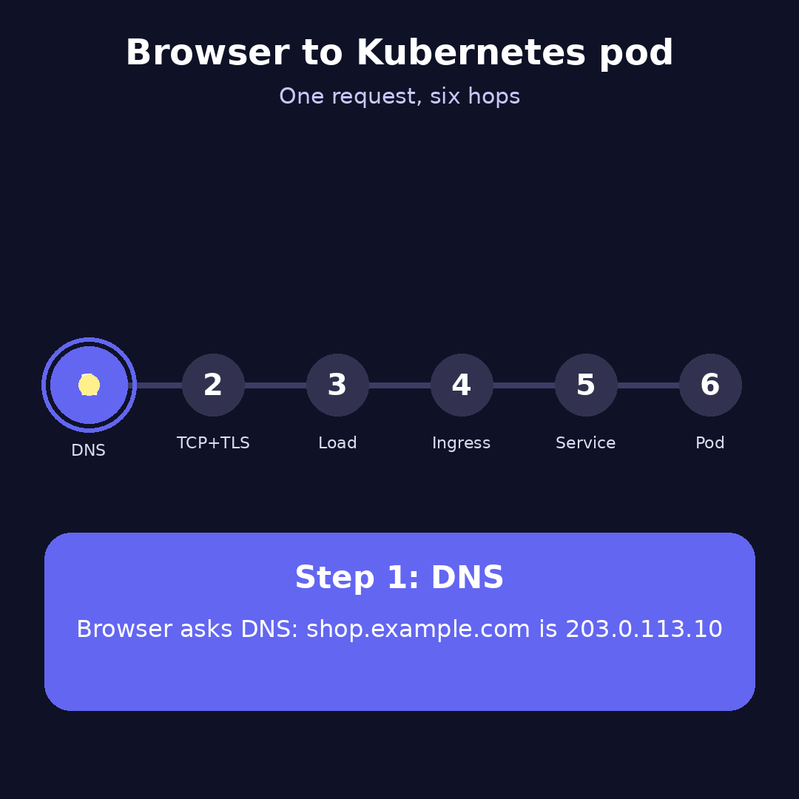
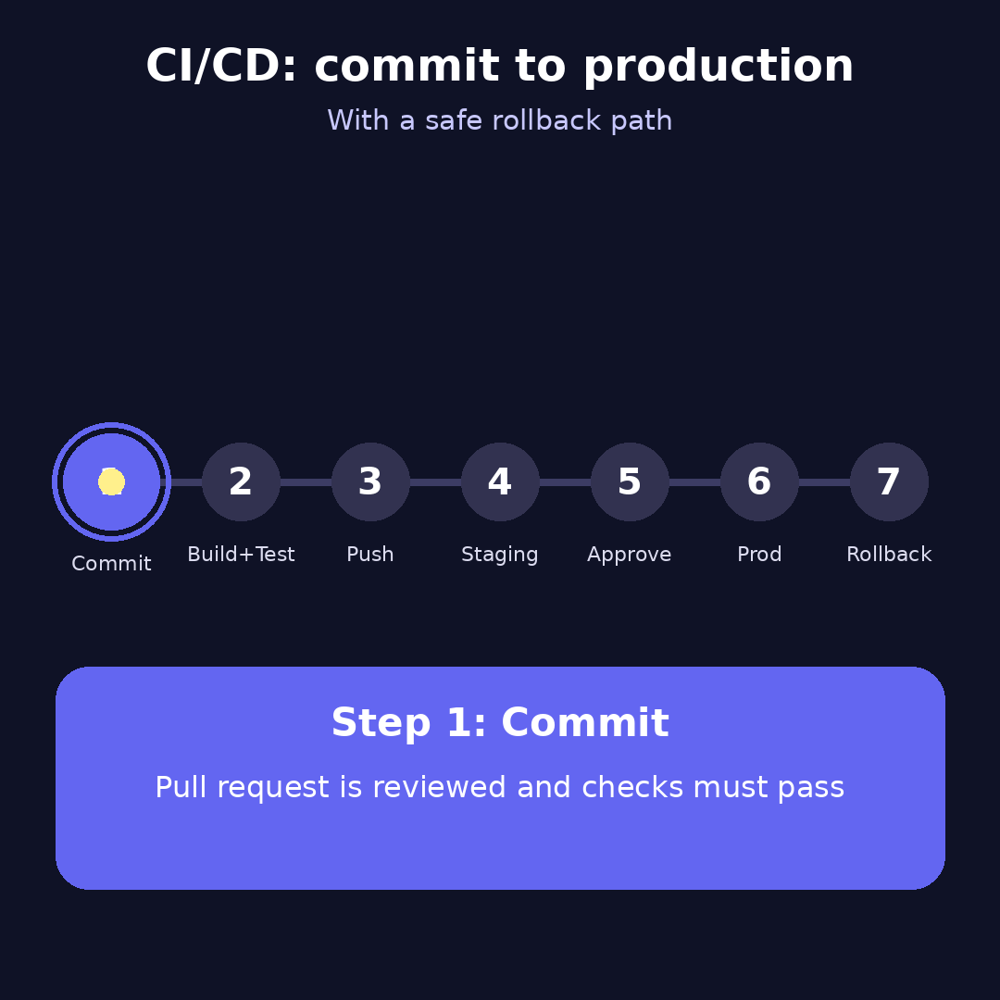

# The DevOps Story: One Shop, One Click, Zero Downtime

Meet Maya. She runs an online shop, `shop.example.com`. Every day, thousands of people click "Buy." Maya's job, as the DevOps engineer, is to make sure those clicks always work, and that new features reach customers without breaking anything.

This story walks through her day in order. Each part answers one interview question in plain language. The full answers are in [DevOps_Interview_QA.md](DevOps_Interview_QA.md).



## Part 1: The click

A customer types `shop.example.com` and presses Enter.

1. **The phone book (DNS).** The browser asks, "Where is shop.example.com?" The answer is an address, like a street number for the shop.
2. **The secure door (TLS).** The browser and the server agree on a secret code, so nobody on the road can read the order.
3. **The front desk (load balancer).** Many servers are waiting. The load balancer sends the customer to one that is healthy.
4. **The receptionist (ingress).** The receptionist reads the request. "You want the cart? Go to the cart room."
5. **The room sign (Service).** The cart room has one fixed sign, even though several workers are inside. The sign picks one free worker.
6. **The worker (pod).** The worker answers, and the answer goes back the same way.

**Maya's rule:** when something breaks, check the path in order. Is the phone book right? Is the front desk sending people to healthy workers? Is the sign pointing at the right room?

**Ansible commands for this step**

Check every hop in the path, in order, from one place:

```bash
# Phone book: does DNS return the right address?
ansible all -m command -a "dig +short shop.example.com"

# Secure door: is the certificate valid and not expiring soon?
ansible all -m command -a "openssl s_client -connect shop.example.com:443 -servername shop.example.com </dev/null 2>/dev/null | openssl x509 -noout -enddate"

# Front desk and workers: does the load balancer return healthy answers?
ansible lb -m uri -a "url=https://shop.example.com/healthz status_code=200"

# Receptionist, sign and worker: check the ingress and service inside the cluster
ansible k8s_masters -m command -a "kubectl get ingress,svc -n shop"
```

## Part 2: The packing box (Docker)

Maya packs each app into a container, a sealed box with everything it needs.

- `docker run` opens the box, gives it its own space and a limited amount of memory, and starts the app.
- The box has two labels: **ENTRYPOINT** is the main job ("always run the app"), and **CMD** is the default option ("use port 8000 unless told otherwise").

**Ansible commands for this step**

Start a container from a playbook, with its memory limit and command set:

```bash
ansible-playbook -i inventory.ini run_shop_container.yml
```

```yaml
# run_shop_container.yml
- hosts: app_servers
  tasks:
    - name: Run the shop container
      community.docker.docker_container:
        name: shop
        image: registry.example.com/shop:1.4.2
        state: started
        restart_policy: unless-stopped
        memory: 512m
        ports: ["8000:8000"]
        command: ["--port", "8000"]   # overrides CMD, keeps the ENTRYPOINT
```

## Part 3: Keeping the workers running (Kubernetes)

Maya uses Kubernetes as a manager for the workers.

- **Deployment:** "Always keep 3 copies of the shop running."
- **StatefulSet:** "The database workers each have a name and a locker that stays with them."
- **DaemonSet:** "One monitoring helper on every computer."
- **Job:** "Run the nightly cleanup once, then stop."

Two checks keep the workers honest:
- **Readiness:** "Are you ready for customers?" If not, the sign stops sending people to you. You are not restarted.
- **Liveness:** "Are you still alive?" If not, the manager restarts you.

When a worker keeps crashing (CrashLoopBackOff), Maya reads its last words in the logs before she changes anything.

**Ansible commands for this step**

Apply the Deployment, StatefulSet, DaemonSet and Job manifests, then check them:

```bash
ansible-playbook -i inventory.ini k8s_deploy.yml
ansible k8s_masters -m command -a "kubectl rollout status deployment/shop -n shop"
ansible k8s_masters -m command -a "kubectl logs deployment/shop -n shop --previous"   # for CrashLoopBackOff
```

```yaml
# k8s_deploy.yml (uses the kubernetes.core collection)
- hosts: localhost
  tasks:
    - name: Apply the shop Deployment (3 replicas)
      kubernetes.core.k8s:
        state: present
        src: manifests/shop-deployment.yaml
        namespace: shop
```

## Part 4: Shipping new features safely (CI/CD)

Every change follows the same road:

1. A developer submits the change for review.
2. Tests and security scans run automatically.
3. The image is labelled with the change's ID and stored.
4. It goes to a test shop (staging) first.
5. A person approves it for the real shop.
6. Workers are replaced gradually, so customers never see an empty shop.



If errors jump, Maya presses one button: **roll back**. The shop returns to yesterday's version in minutes.

**Ansible commands for this step**

Deploy to staging first, then to production after approval, one batch at a time:

```bash
# Staging first
ansible-playbook -i inventory.ini deploy.yml --limit staging -e image_tag=a1b2c3d

# Production, after approval, rolling one server at a time
ansible-playbook -i inventory.ini deploy.yml --limit production -e image_tag=a1b2c3d -e serial_batch=1

# The roll back button: return to yesterday's tag
ansible-playbook -i inventory.ini deploy.yml --limit production -e image_tag=previous
```

`serial_batch=1` is what keeps customers from seeing an empty shop: each server is replaced before the next one starts.

## Part 5: The safe, locked storage room (Terraform)

Maya describes all the shop's infrastructure in code. Before any change, she runs a plan that shows exactly what will change.

- **Lock:** only one person can change the infrastructure at a time.
- **Stable names:** each item has its own name, so removing one does not rename the rest.
- **Drift check:** if someone changes something by hand, the nightly check catches it.

**Ansible commands for this step**

Run Terraform through Ansible, so the plan is reviewed before the apply:

```bash
# Show the plan (nothing changes yet)
ansible-playbook -i inventory.ini terraform.yml -e tf_action=plan

# Apply only the saved plan, after review
ansible-playbook -i inventory.ini terraform.yml -e tf_action=apply -e plan_file=tfplan

# Drift check: report changes made by hand, change nothing
ansible-playbook -i inventory.ini drift_check.yml --check --diff
```

```yaml
# terraform.yml (uses the community.general collection)
- hosts: localhost
  tasks:
    - name: Run terraform
      community.general.terraform:
        project_path: infra/
        state: "{{ 'planned' if tf_action == 'plan' else 'present' }}"
        plan_file: "{{ plan_file | default(omit) }}"
```

## Part 6: Watching the shop (monitoring)

Maya watches three things:
- **Logs:** the story of each event.
- **Metrics:** the numbers over time, like how many orders per minute.
- **Traces:** the path of one customer's order, showing exactly which step was slow.

Alerts go to a person only when customers are affected, not for every small blip.

**Ansible commands for this step**

Install the logs, metrics and traces agents on every host, and confirm they run:

```bash
ansible-playbook -i inventory.ini monitoring.yml --tags node_exporter,prometheus,otel_collector
ansible all -m command -a "systemctl is-active node_exporter otelcol"
```

## Part 7: Keeping the shop safe

- Container images are scanned and signed before they run.
- Each person gets only the permissions their job needs.
- Passwords are kept in a vault, not in code.
- A disaster plan says how long the shop can be down and how much data can be lost, and it is tested.

**Ansible commands for this step**

Scan, lock down and store secrets safely:

```bash
# Store passwords in an encrypted vault, not in code
ansible-vault create group_vars/all/vault.yml

# Apply the security baseline; --check shows what would change first
ansible-playbook -i inventory.ini security_baseline.yml --check --diff
ansible-playbook -i inventory.ini security_baseline.yml --ask-vault-pass

# Install the collections used above
ansible-galaxy collection install community.docker kubernetes.core community.general
```

---

**The moral of Maya's story:** a good DevOps system is one where every step is visible, every change can be undone, and customers never notice that anything changed.
