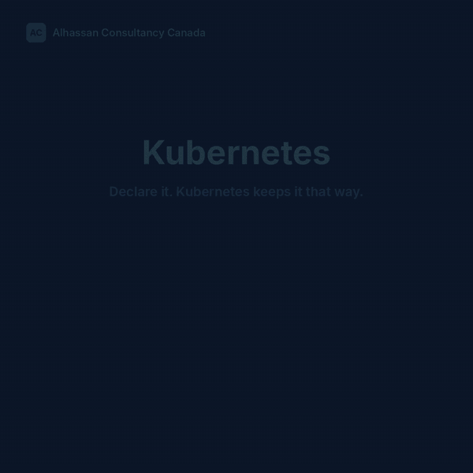

# Kubernetes Administration: From Linux Fundamentals to Production Operations

> A practical guide to Kubernetes (K8s), containers, cluster architecture, installation, deployment, troubleshooting, security, and day-2 operations.
>
> **Audience:** Linux/UNIX administrators, DevOps engineers, SREs, research-computing teams, and AI platform engineers.
>
> **Safety:** All commands are examples. Verify versions, context, namespaces, and permissions before running them; never run disruptive examples against production.



*The guide in motion: cluster architecture, declaring desired state, self-healing, scaling, Services, and the senior troubleshooting framework. [Full-resolution video](media/kubernetes-admin.mp4).*

## 1. What is Kubernetes?

Kubernetes is an open-source **container orchestration** platform. It schedules containerized workloads across nodes, maintains a declared desired state, supports service discovery and scaling, and orchestrates rolling deployments.

For example: declare that an application needs three replicas, and a Deployment controller works to keep three healthy pod replicas available. Kubernetes does not fix application bugs or guarantee recovery from data corruption.

### What it is used for

| Capability | Practical use |
| --- | --- |
| Deployments | Run applications consistently across nodes |
| Self-healing | Replace failed pods and restart containers based on failure conditions |
| Scaling | Adjust replica count manually or using autoscalers |
| Services | Give groups of pods stable discovery and network access |
| Rolling updates | Replace application versions gradually |
| Storage orchestration | Mount volumes using PersistentVolumes and CSI drivers |
| Security | Apply RBAC and workload security controls |
| GPU workloads | Schedule GPU-enabled workloads with appropriate device plugins/operators |

## 2. Architecture

```text
                         Administrator / CI/CD
                                kubectl
                                   |
                            Kubernetes API
                                   |
             +-------------------------------------------+
             |                CONTROL PLANE              |
             | API Server | Scheduler | Controller Mgr   |
             |                 etcd                      |
             +-------------------------------------------+
                      |                       |
            +------------------+    +------------------+
            | Worker Node 1    |    | Worker Node 2    |
            | kubelet          |    | kubelet          |
            | containerd/CRI-O |    | containerd/CRI-O |
            | Pod A / Pod B    |    | Pod C / Pod D    |
            +------------------+    +------------------+
```

**Control plane:** API server processes requests; scheduler selects nodes; controllers reconcile desired state; etcd persists cluster state. **Workers:** kubelet manages assigned pods; the container runtime executes containers; the CNI implementation provides pod networking.

## 3. Key concepts

| Resource | Description |
| --- | --- |
| Node | Cluster machine (VM or physical) |
| Pod | Smallest deployable compute unit; one or more tightly coupled containers |
| Deployment | Declarative lifecycle for replicated stateless applications |
| ReplicaSet | Maintains a desired number of matching pod replicas |
| Service | Stable access/discovery for matching backends |
| Namespace | Logical resource scope; not a complete security boundary |
| ConfigMap | Non-secret configuration |
| Secret | Sensitive configuration object; requires encryption, RBAC, and safe handling |
| StatefulSet | Stateful workloads with stable identity/storage association |
| DaemonSet | Runs workload pods on eligible nodes |
| PersistentVolumeClaim | A workload's request for storage |
| Ingress / Gateway API | HTTP routing when an appropriate controller is installed |
| Helm | Package manager for Kubernetes applications |

## 4. Choose an installation method

- **Minikube:** local lab on Linux/macOS/Windows.
- **kind:** fast container-based clusters, convenient for tests.
- **kubeadm:** build and operate your own Linux cluster.
- **K3s:** lightweight distributions for edge and labs.
- **EKS / AKS / GKE:** managed Kubernetes platforms on AWS, Azure, and Google Cloud.

For your first lab, choose **Minikube**. For deeper administrator experience, build a separate **kubeadm** cluster on three Linux VMs.

### Minikube on macOS with Homebrew and Docker Desktop

```bash
brew install --cask docker
brew install minikube kubectl
# Start Docker Desktop, then:
minikube start --driver=docker
kubectl get nodes -o wide
kubectl cluster-info
```

### Minikube on Linux x86-64

First install and configure a supported Docker Engine or other Minikube driver using its official documentation. Then install Minikube:

```bash
curl -LO https://github.com/kubernetes/minikube/releases/latest/download/minikube-linux-amd64
sudo install minikube-linux-amd64 /usr/local/bin/minikube
```

Install `kubectl` using the official Kubernetes client instructions, and confirm the Docker engine is accessible:

```bash
minikube start --driver=docker
kubectl get nodes -o wide
kubectl get pods -A
```

> Download artifacts from trusted sources, verify checksums/signatures where available, and choose the appropriate CPU architecture (for example, ARM64 rather than AMD64 when required).

Official documentation: [Minikube start](https://minikube.sigs.k8s.io/docs/start/) · [Install kubectl](https://kubernetes.io/docs/tasks/tools/).

## 5. Hands-on lab: deploy, serve, scale, and self-heal NGINX

```bash
# Create isolated test namespace
kubectl create namespace k8s-lab

# Deploy two web-server replicas
kubectl create deployment nginx --image=nginx:stable --replicas=2 -n k8s-lab
kubectl rollout status deployment/nginx -n k8s-lab
kubectl get pods -n k8s-lab -o wide

# Create an internal service
kubectl expose deployment nginx --port=80 --target-port=80 --type=ClusterIP -n k8s-lab

# Local access: keep this running in one terminal
kubectl port-forward -n k8s-lab service/nginx 8080:80
```

In another terminal:

```bash
curl http://127.0.0.1:8080/
```

Scale the Deployment:

```bash
kubectl scale deployment/nginx --replicas=5 -n k8s-lab
kubectl get pods -n k8s-lab
```

**Demonstrate self-healing in the lab only:** identify a pod, delete it, then watch the Deployment replace it.

```bash
kubectl get pods -n k8s-lab
kubectl delete pod POD_NAME -n k8s-lab
kubectl get pods -n k8s-lab -w
```

Clean up after the exercise (deletes the namespace and its contained resources):

```bash
kubectl delete namespace k8s-lab
```

## 6. Administration command cheat sheet

| Goal | Command |
| --- | --- |
| Check selected context | `kubectl config current-context` |
| Cluster status | `kubectl cluster-info` |
| Node details | `kubectl get nodes -o wide` |
| Pods across namespaces | `kubectl get pods -A` |
| Deployments | `kubectl get deploy -A` |
| Services | `kubectl get svc -A` |
| Pod diagnostic details | `kubectl describe pod POD_NAME -n NAMESPACE` |
| Container logs | `kubectl logs POD_NAME -n NAMESPACE` |
| Previous crashed instance logs | `kubectl logs POD_NAME -n NAMESPACE --previous` |
| Events | `kubectl get events -A --sort-by=.lastTimestamp` |
| Resource utilization | `kubectl top pods -A` (requires Metrics Server) |
| Scale replicas | `kubectl scale deploy APP --replicas=3 -n NAMESPACE` |
| Review rollout | `kubectl rollout history deploy/APP -n NAMESPACE` |
| Rollback after compatibility review | `kubectl rollout undo deploy/APP -n NAMESPACE` |

## 7. Troubleshooting runbooks

### CrashLoopBackOff

```bash
kubectl describe pod POD_NAME -n NAMESPACE
kubectl logs POD_NAME -n NAMESPACE --previous
```

Inspect exit codes, OOMKilled events, probes, secrets, mounted configs, and upstream dependencies.

### Pending pods

```bash
kubectl describe pod POD_NAME -n NAMESPACE
kubectl get nodes
kubectl get pvc -n NAMESPACE
```

Check scheduling events, resource requests, taints/tolerations, affinity, topology constraints, and storage provisioning.

### 504 / unreachable application

```bash
kubectl get svc,endpointslices -n NAMESPACE
kubectl get ingress -n NAMESPACE
kubectl logs deployment/APP -n NAMESPACE --since=15m
```

Follow request path from load balancer/Ingress to Service/EndpointSlice to pod and dependencies. Inspect p95/p99 latency, upstream timeouts, DNS and network policy. Healthy pods alone do not prove healthy requests.

### Node NotReady (on the affected Linux node)

```bash
sudo systemctl status kubelet
sudo journalctl -u kubelet -n 100
sudo systemctl status containerd
df -h
free -h
```

Examine kubelet/runtime state, disk/memory pressure, CNI/network connectivity, node certificates and upstream API access.

## 8. Multi-node kubeadm cluster: administrator learning path

Example topology for a **lab only**:

| VM | Purpose | Example private IP |
| --- | --- | --- |
| cp01 | Control plane | 192.168.56.10 |
| worker01 | Worker | 192.168.56.11 |
| worker02 | Worker | 192.168.56.12 |

1. Prepare compatible Linux hosts and consistent time synchronization.
2. Configure network/firewall, containerd and kernel requirements.
3. Configure swap according to the specific kubelet version and settings.
4. Install matching `kubelet`, `kubeadm`, and `kubectl` packages from official repositories.
5. Initialize the control plane, using an appropriate advertise address and pod network CIDR.
6. Install a CNI plugin compatible with your cluster.
7. Join worker nodes using the generated join command.
8. Validate CoreDNS, networking, pod scheduling, and storage.

Example of the **initialization step only**, after prerequisites are complete:

```bash
sudo kubeadm init --apiserver-advertise-address=192.168.56.10
mkdir -p "$HOME/.kube"
sudo cp /etc/kubernetes/admin.conf "$HOME/.kube/config"
sudo chown "$(id -u):$(id -g)" "$HOME/.kube/config"
```

**Important:** `admin.conf` is a privileged credential. Protect it. This is not a complete turnkey production installation. Production clusters require HA, networking design, security baselines, backups and documented upgrades.

Official documentation: [Creating a cluster with kubeadm](https://kubernetes.io/docs/setup/production-environment/tools/kubeadm/create-cluster-kubeadm/).

## 9. Day-2 administration and security

- **RBAC:** limit user and service-account permissions; separate environments.
- **Secrets:** enforce encryption at rest and secure secret delivery; avoid committing credentials.
- **Node management:** use `kubectl cordon` and `kubectl drain` only with workload availability and disruption budgets understood.
- **Monitoring:** use service-level indicators, metrics (Prometheus/Grafana), logs, traces, and actionable alerts.
- **Storage:** know your CSI driver, reclaim policy, backup consistency, and restore process.
- **Updates:** review version skew and add-on compatibility; rehearse the upgrade and rollback/recovery strategy.
- **Capacity:** set resource requests/limits, check pending pods, autoscaling behavior, and quota.
- **Disaster recovery:** back up etcd appropriately and test restoring both cluster and application data.

## 10. Kubernetes in AI, HPC, and research computing

Kubernetes can orchestrate inference services, GPU-enabled containers, batch jobs and distributed ML training workloads. GPU usage typically requires a compatible driver, device plugin, and optionally the NVIDIA GPU Operator. Monitor GPU utilization and errors separately from CPU metrics. Kubernetes complements, but does not automatically replace, Slurm in HPC environments.

## 11. Four-week learning plan

| Week | Focus | Practical milestone |
| --- | --- | --- |
| 1 | Pods, Deployments, Services, namespaces | NGINX lab, scaling, self-healing |
| 2 | Logs, DNS, CNI, ingress, storage | Diagnose a deliberate app failure |
| 3 | kubeadm, RBAC, observability | Three-node Linux lab with monitoring |
| 4 | Helm, GitOps, rollouts, GPU scheduling | Versioned deployment with a tested recovery process |

## 12. Senior-level interview answer framework

When asked how you would troubleshoot production Kubernetes:

1. **Impact:** Which customers, requests, regions, and services are failing?
2. **Evidence:** What do metrics, logs, traces, Kubernetes events and recent changes show?
3. **Hypothesis:** Which layer is most likely failing?
4. **Containment:** What is the smallest safe change that restores service?
5. **Verification:** Did user-facing latency/errors and business transactions recover?
6. **Prevention:** What observability, automation, tests or runbooks will prevent recurrence?

**A green Pod status is not evidence that the end-to-end service is healthy.**

---

### Official references

- [Kubernetes documentation](https://kubernetes.io/docs/home/)
- [Kubernetes concepts](https://kubernetes.io/docs/concepts/)
- [Kubernetes tasks](https://kubernetes.io/docs/tasks/)
- [Minikube](https://minikube.sigs.k8s.io/docs/start/)
- [Helm](https://helm.sh/docs/)

Maintained as an educational guide. Adjust every example to the installed Kubernetes version and environment.
